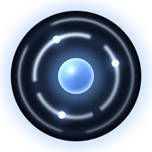
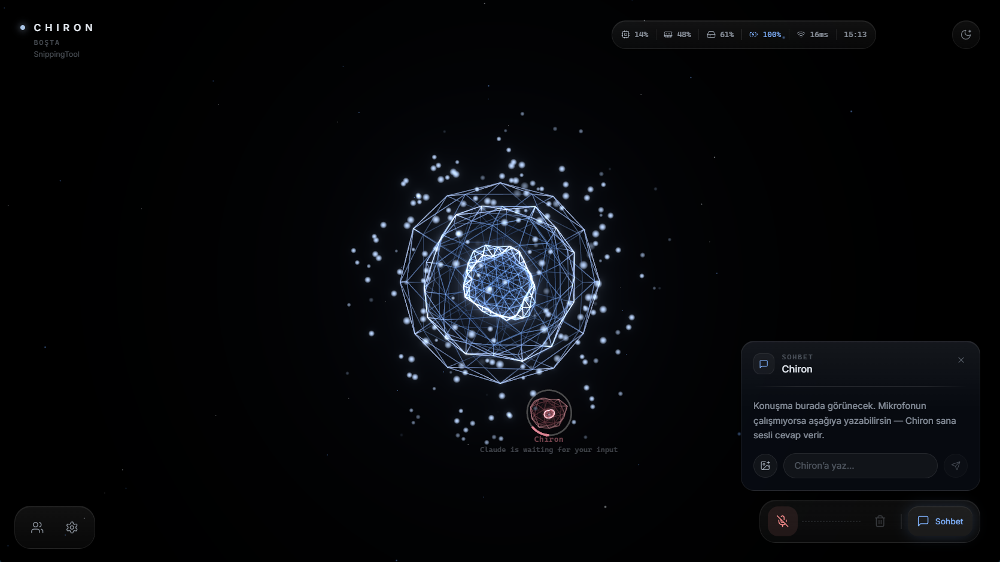

# Chiron

**Sesle konuşulan, ekranı gören, işi ajan ekibine dağıtan bir masaüstü yapay zekâ ortamı.**

A voice-driven AI operating environment for Windows: live voice, local vision, a 3D WebGL interface and a team of coding agents.

---

> **Bu depo tanıtım amaçlıdır.** Kaynak kod özel bir depoda duruyor.
> Kodu görmek isteyenler için: [erişim isteği aç](../../issues/new?template=erisim-istegi.md).
>
> **This repository is a showcase.** The source code lives in a private repository.
> To request read access, [open an access request](../../issues/new?template=erisim-istegi.md).

## In short (English)

Chiron is a desktop AI environment I design and build on my own. You talk to it, it sees the
screen and the camera, it can operate the computer, and it hands longer work to a small team of
AI agents that plan, write, test and review code in isolated copies of a project.

- **Stack:** Python (FastAPI, asyncio), TypeScript (Next.js, React, three.js), Android companion app
- **AI:** Gemini Live for real-time voice, Claude Code / Codex / Gemini CLI as agent engines, local
  models for vision (YOLO-World, EasyOCR)
- **Scale:** 60+ voice tools, 800+ automated tests, an MCP server, a phone companion over a private network

## Bu ne?

Chiron bir sohbet botu değil. Kendi penceresinde çalışan, sürekli açık duran bir yapay zekâ
ortamı: konuşarak yönetiliyor, kamerayı ve ekranı görüyor, bilgisayarı kullanabiliyor ve bazı
şeyleri istenmeden fark edip haber veriyor.

Arayüz gerçek bir 3D sahne. Ortadaki çekirdek Chiron'un durumuna göre davranıyor; çevresindeki
küçük gövdeler o an çalışan ajan oturumları.

## Neler yapabiliyor

**Ses.** Türkçe, sürekli dinleme, gerçek zamanlı sesli cevap. Mikrofon yoksa yazarak da
konuşulur.

**Görü.** Canlı kamera, nesne tanıma ve metin okuma. İkisi de yerel çalışır; internet ve kota
gerektirmez.

**Ekran.** Ekranı okur, sorulanı gösterir, istenirse fare ve klavyeyle müdahale eder. Geri
alınamayan her eylem önce onay ister.

**Proaktif.** "Şunu izle, olunca haber ver" denebilir. Sistem sağlığı ve günlük brifing de aynı
yoldan gelir.

**Hafıza.** Kalıcıdır; öğrendiğini saklar, sonraki konuşmada kullanır.

**Ajan ofisi.**
- *Kadro:* adı, rolü, talimatı ve kendi hafızası olan ajanlar.
- *İş panosu:* her kart ayrı bir git kopyasında yapılır, testleri koşulur, sonra birleşir.
- *Görev yürütücü:* öğren, planla, uygula, doğrula; sonunda kanıt gösterir.
- *Terminal:* her ajanın canlı bölmesi; ne yazdığı, hangi komutu koştuğu görünür.
- *Gözetim:* makinedeki bütün ajan oturumları tek ekranda.

**Kendini geliştirme.** Chiron kendi istek listesinden iş alır, ayrı kopyada yazar, testleri
geçerse birleştirir. Hassas dosyalarda insana sorar.

**Telefon.** Android uygulaması özel ağ üzerinden bağlanır: durumu izleme, onay verme, sesle
görev bırakma.

**MCP sunucusu.** Chiron'un bazı yetenekleri (ekran metni, etkin uygulama, hafıza araması,
bildirimler) başka yapay zekâ araçlarına salt okunur olarak açıktır.

## Mimari, kısaca

| Katman | Ne |
|---|---|
| Ses döngüsü | Gerçek zamanlı ses oturumu, araç çağrıları, süre sınırları |
| Sunucu | FastAPI; iş kuyruğu, paralel şeritler, kota freni, güvenlik bekçisi |
| Ajan motorları | Claude Code, Codex, Gemini CLI; iş başına ayrı çalışma kopyası |
| Arayüz | Next.js + three.js; 3D çekirdek, ofis ekranları |
| Telefon | Android uygulaması, özel ağ + PIN |

## Yol haritası

- Tek canlı oturum çekirdeği: akan cevap, söz kesme, izin kartları
- Ekipler: her ekibin kendi üyeleri, hafızası, bağlantıları ve panosu
- Lider planlar, alt ajanlara dağıtır, inceletir, tek onay ister
- Çoklu motor ve model kataloğu
- Araç bağlantıları (MCP) ve üretim araçları

## Kod

Kaynak kod özeldir ve bu depoda yer almaz. İşe alım, iş birliği ya da inceleme için okuma
erişimi istenebilir: [erişim isteği aç](../../issues/new?template=erisim-istegi.md).

© 2026 Yunus Emre Uluç. Tüm hakları saklıdır.
